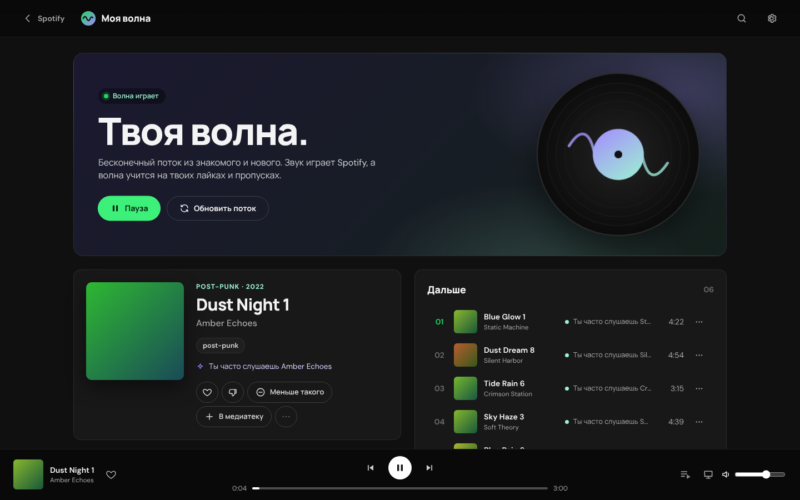

# Songwave — «Моя волна» для Spotify

Расширение для Chromium (Chrome, Edge, Brave), которое добавляет в Spotify Web Player бесконечную персональную волну в духе
Моей волны Яндекс Музыки. Звук играет сам Spotify, расширение подбирает треки и учится на твоих лайках и пропусках.

> **Статус: v0.1, не проверено на живом Spotify.** Логика и интерфейс покрыты 65 автотестами и 46 проверками в настоящем Chromium,
> но против **мока** Spotify. Список того, что нужно сверить на живом аккаунте, в [docs/SPIKE.md](docs/SPIKE.md).



## Установка

Нужны: Chromium-браузер, Spotify **Premium**, Node.js 20+ (только для сборки).

1. Склонируй репозиторий и собери расширение:
   ```bash
   npm ci
   npm run build        # результат в dist/
   ```
   Готовая сборка уже лежит в `dist/`, так что этот шаг можно пропустить.
2. `chrome://extensions` → включи «Режим разработчика» → «Загрузить распакованное расширение» → папка `dist/`.
3. Создай приложение на [developer.spotify.com/dashboard](https://developer.spotify.com/dashboard) (режим разработки):
   - в **Redirect URIs** добавь `https://jnnecfapddigjjfgddampilmakglkidf.chromiumapp.org/`
     (ID расширения зафиксирован ключом в манифесте; точный адрес показывает и экран входа);
   - в **User Management** добавь свой аккаунт (в режиме разработки максимум 5 пользователей);
   - скопируй **Client ID** (секрет не нужен).
4. Открой [open.spotify.com](https://open.spotify.com), нажми кнопку **«Моя волна»** справа внизу (или `Alt+Shift+W`, или значок расширения),
   вставь Client ID и войди.
5. Нажми «Слушать волну».

## Что умеет

- Бесконечная волна: знакомое и новое, ползунок «доля нового», пять пресетов, режимы «Любимое», «Незнакомое», «Без слов», настроения.
- Оценки: нравится, не нравится (сразу следующий), «меньше такого» (слабый минус), «в медиатеку» Spotify, не играть артиста.
- Очередь «Дальше» с причинами («Ты часто слушаешь…»), выбор трека из очереди, поиск, устройства Spotify Connect, громкость.
- Профиль вкуса: любимые жанры и артисты, метрики, чему научилась формула. Экспорт и импорт профиля.
- Состояния: загрузка, пустая история (онбординг), истёкшая сессия, нет устройства, нет Premium, лимит запросов, нет связи.
- Клавиши (когда фокус в оверлее): `Пробел` пауза, `N` дальше, `L` нравится, `D` не нравится, `/` поиск, `Esc` назад.

Горячие клавиши и звук не конфликтуют со Spotify: оверлей перехватывает нажатия, а плеер один, сам Spotify.

## Честные ограничения

- Spotify в режиме разработки не отдаёт рекомендации, popularity и audio features. «Спокойнее», «Энергичнее» и «Без слов» — приближения по жанрам.
- Очередь Spotify нельзя перестроить через API: два следующих трека «заморожены», остальное волна пересобирает после твоих оценок.
- Состояние плеера читается опросом, поэтому реакция на действия в самом Spotify может отставать на пару секунд.
- Shuffle и repeat не нужны волне и не реализованы.
- Дизайн из `design/` в репозитории **повреждён**: архив обрезан на 11 КБ, целиком читаются только текстовые файлы
  (`design/recovered/`). Интерфейс собран по спецификации. Если есть исходники прототипа, пришли их, и я сверю вёрстку.

## Разработка

```bash
npm test                 # 65 юнит-тестов: API-клиент, вход, движок, плеер, приложение, симуляция качества
npm run e2e              # Chromium + тестовая сборка + мок Spotify; скриншоты в test/e2e/out/shots
npm run build            # боевая сборка в dist/
npm run zip              # songwave-extension.zip из dist/
```

Для e2e нужен Playwright с Chromium (`NODE_PATH=$(npm root -g) npm run e2e`, если Playwright стоит глобально).

Структура: `src/core` (движок и плеер, без браузера), `src/spotify` (API-клиент), `src/extension` (вход, service worker, приложение, интерфейс),
`test` (юнит, мок Spotify, e2e), `docs` ([архитектура и алгоритм](docs/ARCHITECTURE.md), [живая проверка](docs/SPIKE.md), [условия Spotify](docs/POLICY.md)).

Лицензия: MIT.
